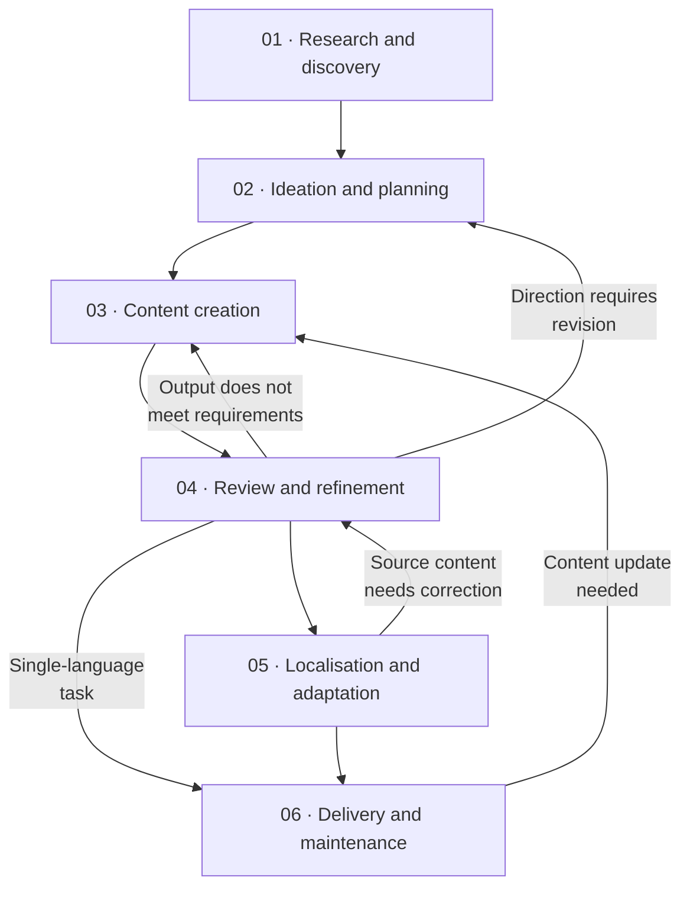

# Master Workflow

The complete human-led AI content workflow: six lifecycle stages, human oversight, stage transitions, and individual and team operating modes.

## Contents

- [Purpose and scope](#purpose-and-scope)
- [The content lifecycle](#the-content-lifecycle)
- [Workflow diagram](#workflow-diagram)
- [Stage overview](#stage-overview)
- [Individual operating mode](#individual-operating-mode)
- [Collaborative team operating mode](#collaborative-team-operating-mode)
- [Stage transitions and returns](#stage-transitions-and-returns)
- [Supporting resources](#supporting-resources)

---

## Purpose and scope

This document is the central reference for the AI Content Workflow. It describes the complete process for AI-assisted content work and explains how to apply it individually or as part of a small team.

Read this document to understand:

- How the six lifecycle stages connect
- What is needed at each stage and what each stage produces
- When human intervention is required
- How to work through the process independently or with a small team
- When work can return to an earlier stage

Detailed instructions for each stage are in the `stages/` directory. Supporting templates are in the `templates/` directory. Human oversight requirements are in `human-checkpoints.md`.

---

## The content lifecycle

The framework organises AI-assisted content work into six connected stages.

| Stage | Purpose | Primary AI contribution | Primary human accountability |
|---|---|---|---|
| 01. Research and discovery | Examine existing content, synthesise supplied research, and identify potential gaps | Organise and summarise supplied information; identify patterns in existing material | Define research questions; assess evidence; decide which findings are relevant |
| 02. Ideation and planning | Explore ideas, establish requirements, and plan the content approach | Generate possible approaches; organise requirements; suggest content structures | Provide creative direction; prioritise ideas; select the approach |
| 03. Content creation | Draft, restructure, and adapt content | Support drafting; generate alternatives; adapt content for different formats | Establish the brief; guide generation; evaluate whether output meets requirements |
| 04. Review and refinement | Evaluate content against requirements, voice guidelines, and content standards | Assist with voice alignment, clarity, consistency, and accessibility checks | Interpret findings; resolve conflicting recommendations; make editorial decisions |
| 05. Localisation and adaptation | Translate, adapt, and validate content for other languages and cultural contexts | Support translation; assist with terminology checks; identify adaptation requirements | Provide linguistic and cultural judgement; involve qualified reviewers; approve each locale |
| 06. Delivery and maintenance | Coordinate handoffs, approve deliverables, and manage future updates | Support documentation; summarise changes; identify content requiring future review | Approve deliverables; manage publication readiness; maintain records |

The stages provide a shared structure rather than a fixed production sequence. Work may return to an earlier stage when review findings, new requirements, or changing circumstances call for revision. See [Stage transitions and returns](#stage-transitions-and-returns).

---

## Workflow diagram

The diagram shows the typical sequence through the six stages and the common return paths. Arrows between non-adjacent stages indicate that returns are possible when significant issues arise, not that every task will follow every path.

Stage 05 (Localisation and adaptation) is conditional. Tasks that do not involve multiple languages or cultural contexts move directly from stage 04 to stage 06.

Return paths in the diagram represent the most common patterns. The delivery-stage return destination depends on the scope of the update — see [Stage transitions and returns](#stage-transitions-and-returns).

---

## Stage overview

This section summarises each stage's inputs, outputs, entry conditions, exit conditions, and applicable checkpoints. It provides enough detail to understand and operate each stage without opening every stage document. Detailed instructions, activity-level guidance, checklists, and Phase 4 references are in the corresponding stage files.

---

### Stage 01 — Research and discovery

Establish what is known, what exists, and what may be missing before content work begins.

**Required inputs**

- Defined research questions or audit objectives
- Existing content, supplied research, or brief
- Relevant constraints (scope, audience, format, language)

**Expected outputs**

- Organised findings
- Summary of relevant existing content
- Identified gaps or opportunities
- Notes on evidence quality and limitations

**Entry conditions**

The task objectives and scope are defined. The practitioner or team has identified the questions the research should answer.

**Exit conditions**

Findings have been reviewed and evidence has been assessed by the practitioner. A summary is ready to inform the next stage.

**Checkpoint: Direction**

Before AI-assisted research begins, the practitioner confirms that the research questions, scope, and relevant constraints are established. The research agenda is defined by the practitioner, not generated by AI.

---

### Stage 02 — Ideation and planning

Define the content approach, structure, and requirements before drafting begins.

**Required inputs**

- Research findings or brief
- Audience and objectives
- Content requirements and constraints
- Relevant content standards (voice, tone, structure guidelines)

**Expected outputs**

- Chosen content approach
- Content structure or outline
- Requirements and priorities for content creation
- Content brief (if passing to another contributor or stage)

**Entry conditions**

Research findings are available and have been reviewed by the practitioner. The audience, objectives, and constraints are understood.

**Exit conditions**

The content approach, structure, and requirements have been confirmed by the responsible practitioner. A brief is ready for content creation.

**Checkpoints: Direction → Alignment**

The Direction checkpoint confirms that objectives and constraints are established before ideation begins. An Alignment checkpoint follows when AI-generated approaches or structures are reviewed: the practitioner confirms that the selected direction meets the requirements before proceeding to content creation.

---

### Stage 03 — Content creation

Develop content based on the confirmed brief and requirements.

**Required inputs**

- Confirmed brief with objectives, audience, context, and constraints
- Content structure or outline from stage 02
- Relevant voice and tone guidelines
- Applicable content standards (Rules, Recommendations, Contextual guidance) from the AI Content Creation module

**Expected outputs**

- Draft content meeting the brief
- Documented alternatives where relevant
- Notes on significant decisions or trade-offs

**Entry conditions**

A confirmed brief is available. The practitioner understands the voice, tone, and content requirements that apply.

**Exit conditions**

The draft has been reviewed by the practitioner, meets the brief, and is ready for structured review and refinement.

**Checkpoint: Alignment**

Intermediate outputs are reviewed before they proceed. The practitioner checks that generated content follows the established brief and direction, using the evaluation criteria in `03-ai-content-creation/output-evaluation-rubric.md` where applicable.

---

### Stage 04 — Review and refinement

Evaluate content against requirements, voice guidelines, content standards, and applicable accessibility and compliance requirements.

**Required inputs**

- Draft content from stage 03
- Voice and tone guidelines
- Content standards and requirements
- Evaluation rubric (`03-ai-content-creation/output-evaluation-rubric.md`)

**Expected outputs**

- Reviewed and refined content
- Documented findings and editorial decisions
- Change log recording what was changed and why

**Entry conditions**

A draft is available and has passed the practitioner's initial assessment from stage 03.

**Exit conditions**

Content meets the requirements, voice guidelines, and applicable standards. The practitioner has completed a final quality review. All decisions are documented where required.

**Checkpoint: Quality**

The practitioner performs a structured quality review. AI can assist with specific checks (voice alignment, consistency, accessibility scanning), but editorial judgement and final decisions remain with the practitioner. See `human-checkpoints.md` for the distinction between mandatory and conditional quality checks.

---

### Stage 05 — Localisation and adaptation

Translate and adapt content for other languages and cultural contexts.

**Required inputs**

- Quality-reviewed source content from stage 04
- Locale requirements and terminology
- Cultural context for target markets

**Expected outputs**

- Translated and adapted content for each locale
- Locale-specific review records
- Approved locale versions

**Entry conditions**

Source content has passed the stage 04 quality review. Locale requirements, terminology, and reviewer availability are confirmed before AI-assisted translation begins.

**Exit conditions**

Each locale version has been reviewed by a qualified linguistic or cultural reviewer. Approval has been recorded for each locale.

**Checkpoint: Localisation**

For each locale, the practitioner or a qualified reviewer validates language accuracy, terminology, meaning, and cultural suitability. AI-assisted translation must not proceed to delivery without this review. See `localisation-workflow.md` for the operational process.

This stage applies to multilingual content tasks only. Single-language tasks proceed directly from stage 04 to stage 06.

---

### Stage 06 — Delivery and maintenance

Finalise, approve, and hand off content. Document decisions and manage future updates.

**Required inputs**

- Quality-reviewed content from stage 04
- Locale-approved versions from stage 05, where localisation applies
- Handoff template
- Final approval checklist

**Expected outputs**

- Approved, documented deliverable
- Completed handoff record
- Final approval record
- Notes on content requiring future review or update

**Entry conditions**

All required reviews are complete and documented. Any outstanding issues have been resolved or recorded with a rationale for acceptance.

**Exit conditions**

Final approval has been given by the responsible practitioner or approver. The handoff record is complete. The content is approved and ready for handoff. Publication or deployment follows the organisation's own release process.

**Checkpoint: Final approval**

Final human review and approval are mandatory for every deliverable. No AI-generated output should be treated as approved simply because it has passed automated checks or intermediate reviews.

---

## Individual operating mode

For practitioners working independently, the workflow provides a repeatable personal process. The key adjustment is that one person holds all responsibilities: defining the brief, guiding AI assistance, reviewing outputs, making decisions, and approving the final deliverable.

**Applying the workflow individually**

The six-stage structure applies in full. The depth of each stage should be proportionate to the task. A minor revision may move quickly through stages 01 and 02, while a new content area benefits from completing each stage thoroughly.

**Checkpoints in individual practice**

Each checkpoint remains meaningful when working alone. Without a separate reviewer, the practitioner performs both the generative and evaluative roles. This requires deliberate separation: complete the AI-assisted activities for a stage, then step back and assess the output against the requirements before moving on.

A useful discipline: treat the stage exit conditions as the minimum requirement before proceeding, and use the stage checklist in the corresponding stage document to confirm readiness. Avoid reviewing content immediately after generating it.

**Using templates individually**

| Template | When to use |
|---|---|
| Content brief | At the start of any task where objectives, context, or constraints need to be explicit |
| Handoff template | When passing work to a reviewer, stakeholder, or colleague |
| Decision and iteration log | For tasks where AI-generated content required significant revision, or where decisions need to be documented |
| Final approval checklist | Before treating any deliverable as complete |

For shorter or lower-risk tasks, the Decision and iteration log can be maintained at a summary level — recording significant decisions and changes rather than every iteration. The Final approval checklist applies in full, as a record that the deliverable has been reviewed before use.

---

## Collaborative team operating mode

For small teams, the workflow coordinates responsibilities, handoffs, and approval authority across contributors.

**Roles in a team workflow**

Team size and structure vary. The framework identifies functional responsibilities rather than fixed job titles. These may be combined when team size requires it, but accountability must remain clear.

| Responsibility | Function |
|---|---|
| Content lead | Owns the brief, the content approach, and final editorial decisions |
| Reviewer | Evaluates content against requirements and provides structured feedback |
| Localisation reviewer | Validates linguistic accuracy and cultural suitability for a specific locale |
| Approver | Authorises the final deliverable for use |

In a small team, one person may hold multiple responsibilities. The requirement is that the approver has reviewed the final deliverable, not that a separate person holds the approval role.

**Handoffs**

Work moves between contributors using the Handoff template. The template records the deliverable, its current status, relevant context, outstanding issues, and the next owner's responsibilities. Clear handoffs reduce the risk of context loss between stages.

**Shared records**

The Decision and iteration log is a shared record for collaborative tasks. It provides a common reference for why content was changed, which AI outputs were used, and which decisions were made. This is particularly useful when multiple contributors are involved across a task's lifecycle.

**Approval authority**

Final approval must be assigned to an identifiable person with the appropriate authority and subject-matter responsibility.

Where practical, approval should be independent of content generation. If roles must be combined, the approver must still conduct a deliberate final review against the approval criteria. Higher-risk content may require an independent specialist or additional reviewer.

---

## Stage transitions and returns

The six stages follow a typical sequence, but content work does not always move forward in a straight line.

**Common return paths**

| Trigger | Return to |
|---|---|
| AI output at stage 03 does not meet the brief and cannot be corrected by refinement | Stage 03 (re-prompt) or stage 02 (revise the brief or approach) |
| Review at stage 04 identifies a fundamental brief or direction problem | Stage 02 (revise direction) or stage 01 (gather missing information) |
| Localisation review identifies a problem with the source content | Stage 04 (revise source content before proceeding with localisation) |
| A delivery stage update requires content changes | Stage 03 (most common); stage 02 if the brief needs revision; stage 04 if only the reviewed version needs correction |

**What triggers a return**

Returns are appropriate when:

- AI output does not meet the brief and cannot be corrected by refinement at the current stage
- New information or requirements change the direction of the work
- A review checkpoint identifies a problem that requires earlier work to be revised
- A localisation reviewer's findings indicate that the source content needs correction

Returns are not appropriate when:

- Minor revisions can be made at the current stage
- The issue is a matter of wording rather than a fundamental direction or quality problem

**Documenting returns**

When work returns to an earlier stage, the reason should be noted in the Decision and iteration log. This helps prevent the same issues from recurring when the work returns to the stage it was returned from, and provides a record of the factors that shaped the final deliverable.

---

## Supporting resources

**Stage documents**

Each lifecycle stage has a detailed instruction document in the `stages/` directory.

| Stage | Document |
|---|---|
| 01. Research and discovery | `stages/01-research-and-discovery.md` |
| 02. Ideation and planning | `stages/02-ideation-and-planning.md` |
| 03. Content creation | `stages/03-content-creation.md` |
| 04. Review and refinement | `stages/04-review-and-refinement.md` |
| 05. Localisation and adaptation | `stages/05-localisation-and-adaptation.md` |
| 06. Delivery and maintenance | `stages/06-delivery-and-maintenance.md` |

**Operating guidance**

| Document | Purpose |
|---|---|
| `human-checkpoints.md` | Mandatory and conditional checkpoints, decision criteria, and responsibility matrix |
| `localisation-workflow.md` | Operational process for AI-assisted multilingual content |
| `implementation-guide.md` | Guidance for introducing and adapting the framework |
| `retrospective-guide.md` | Structured questions for evaluating and improving the workflow |

**Reusable templates**

| Template | Purpose |
|---|---|
| `templates/content-brief-template.md` | Define objectives, audience, context, requirements, and constraints |
| `templates/handoff-template.md` | Transfer work and context between contributors |
| `templates/decision-and-iteration-log.md` | Record AI outputs, decisions, changes, and rationale |
| `templates/final-approval-checklist.md` | Confirm that a deliverable is ready for use |

**Phase 4 resources**

This module builds on the AI Content Creation module (`03-ai-content-creation/`). Key resources referenced within the stage documents include:

| Resource | Relevance to the workflow |
|---|---|
| `ai-content-principles.md` | Foundational principles for AI-assisted content work |
| `grounding-guide.md` | Preparing context and instructions before AI-assisted activities begin |
| `prompt-templates/` | Reusable prompts for common content tasks |
| `output-evaluation-rubric.md` | Evaluation criteria for AI-generated outputs at review and refinement stages |
| `failure-modes.md` | Common problems in AI-assisted content work and how to identify them |
| `worked-examples.md` | End-to-end examples of the evaluation and decision process |
